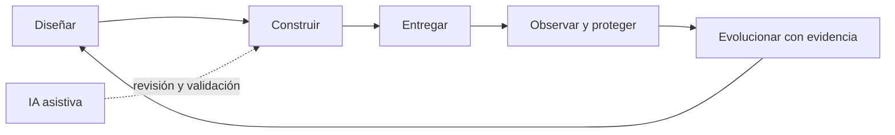

# Informática I: arquitectura de software moderna e IA

Curso práctico de la Especialización en Ingeniería de Software. El repositorio acompaña el libro **Arquitectura de Software Moderna, incluyendo aspectos de IA para el desarrollo** y convierte sus temas en rutas reproducibles de estudio, laboratorio y evaluación.

Preparado por los profesores:

- Dr. Carlos Montenegro Marín
- Dr. Esteban Hernández Barragán

## Propósito

El curso desarrolla los contenidos definidos para Informática I y los relaciona con prácticas contemporáneas de arquitectura y construcción de software. La agenda oficial prioriza la secuencia establecida por el profesor titular; los laboratorios reproducibles, la seguridad, la observabilidad y el uso responsable de IA se incorporan como apoyo o valor agregado, sin sustituir los temas del syllabus. El caso conductor es **LibreReserva**, una API para reservar recursos institucionales.



## Visión moderna del desarrollo y despliegue

El repositorio conserva el código y sus decisiones. Las pruebas y la construcción producen una imagen de contenedor identificable, que se guarda en un registro y se despliega con la configuración del ambiente. Los logs y las mediciones permiten revisar el resultado y orientar el siguiente cambio.


Para crecer sin depender de una instancia concreta, la aplicación procesa solicitudes en réplicas reemplazables. Aunque las réplicas puedan reemplazarse, los datos deben permanecer en servicios separados: base de datos, almacenamiento de archivos/objetos y, cuando corresponde, colas o almacenamiento de sesiones. **Sin estado** describe la ejecución de la aplicación, no un sistema sin datos.


Un proveedor cloud puede aportar cómputo gestionado, balanceo, autoescalado, bases de datos y almacenamiento de objetos. El equipo sigue siendo responsable de las reglas, consistencia, permisos, límites, recuperación y costos. Escalar la API no elimina los cuellos de botella de sus datos ni exige adoptar Kubernetes.

En LibreReserva esta arquitectura se desarrolla por incrementos. La ejecución base conserva memoria para reproducir la sesión 9; la sesión 11 incorpora un puerto de repositorio, PostgreSQL, migración y dos réplicas detrás de Caddy. La [ruta por sesiones](docs/RUTA_CONTENEDORES.md) distingue la línea base de memoria del ambiente integrado, sin exigir toda la arquitectura desde la primera práctica.

Referencias: [procesos sin estado](https://12factor.net/processes), [diseño para escalar horizontalmente](https://learn.microsoft.com/en-us/azure/architecture/guide/design-principles/scale-out) y [elasticidad en cloud](https://docs.cloud.google.com/architecture/framework/performance-optimization).

## Agenda oficial del curso

- Periodo: segundo semestre de 2026.
- Horario de los encuentros: miércoles de 6:00 p. m. a 10:00 p. m.
- Profesor titular: Dr. Carlos Montenegro Marín.
- Primer bloque: ocho sesiones a cargo del Dr. Carlos Montenegro Marín.
- Segundo bloque: ocho semanas académicas a cargo del Dr. Esteban Hernández Barragán.
- Caso conductor y práctica del segundo bloque del Dr. Esteban Hernández: **LibreReserva**. No se asigna como práctica obligatoria en las sesiones del Dr. Carlos Montenegro.

La secuencia conserva los contenidos definidos por el profesor titular. Los materiales adicionales del repositorio se relacionan con cada tema cuando aportan evidencia, práctica o actualización tecnológica.

### Unidad 1. Informática y conceptos básicos

| Semana | Fecha | Profesor | Tema |
|---:|---|---|---|
| 1 | 12 ago. | Carlos Montenegro | Modelo de software frente a arquitectura de software; evolución de las arquitecturas; cliente-servidor, multicapas y arquitectura web |
| 2 | 19 ago. | Carlos Montenegro | UML y su papel en el desarrollo de software; introducción al repositorio |
| 3 | 26 ago. | Carlos Montenegro | Paradigma de programación orientada a objetos; principios de POO y relación entre UML y POO |
| 4 | 2 sep. | Carlos Montenegro | Lenguajes modernos orientados a objetos: Python y Java |
| 5 | 9 sep. | Carlos Montenegro | Lenguajes modernos orientados a objetos: Python y Java |
| 6 | 16 sep. | Carlos Montenegro | Lenguajes modernos orientados a objetos: Python y Java |
| 7 | 23 sep. | Carlos Montenegro | Metapatrón MVC y manejo de comunicaciones |
| 8 | 30 sep. | Carlos Montenegro | Evaluación del primer bloque |

El miércoles 7 de octubre corresponde a la Semana Universitaria y no se programa una sesión ordinaria del curso.

### Unidad 2. Arquitectura de software

| Semana | Fecha | Profesor | Tema y práctica asociada |
|---:|---|---|---|
| 9 | 14 oct. | Esteban Hernández | Docker: construcción de imagen, ejecución de LibreReserva y pruebas de despliegue local |
| 10 | 27 oct. | Esteban Hernández · virtual | Balanceo y persistencia en archivos: dos instancias, Parquet compartido, concurrencia y bloqueo local |
| 11 | 28 oct. | Esteban Hernández | Persistencia e integridad: puerto de repositorio, PostgreSQL, migraciones y concurrencia |
| 12 | 4 nov. | Esteban Hernández | API confiable: idempotencia, errores, disponibilidad y recuperación de dependencias |
| 13 | 11 nov. | Esteban Hernández | Entrega segura y trazable: pruebas, CI, imagen OCI, configuración y secretos |
| 14 | 18 nov. | Esteban Hernández | Operación y recuperación: logs, salud real, medición, respaldo y restauración |
| 15 | 25 nov. | Trabajo de proyecto | Integración desde un clon limpio; jornada autónoma sin temas nuevos |
| 16 | 2 dic. | Esteban Hernández | Demostración de robustez, defensa de decisiones y cierre |

La descripción institucional completa se encuentra en la [agenda del segundo semestre de 2026](docs/AGENDA_16_SEMANAS.md). Si existe una diferencia entre una guía de laboratorio y la agenda, prevalecen el syllabus y las orientaciones del profesor titular.

### Ruta acumulativa del segundo bloque

La [ruta por sesiones](docs/RUTA_CONTENEDORES.md) parte del despliegue Docker alcanzado el 14 de octubre y evoluciona una sola aplicación. LibreReserva continúa como monolito modular en contenedor, PostgreSQL conserva los datos y Compose describe el ambiente local. Las semanas siguientes añaden garantías verificables: integridad, idempotencia, pruebas, trazabilidad, diagnóstico y recuperación.

No se incorporan colas, una segunda implementación serverless ni Kubernetes en la ruta evaluable. Esas tecnologías no corrigen la limitación inmediata de la API: las reservas todavía viven en la memoria del proceso y se pierden al reemplazar el contenedor.

## Dos recorridos que no comparten numeración

### Progreso en AWS Academy Cloud Foundations

| Módulos AWS Academy | Estado en el curso | Uso posterior |
|---|---|---|
| 1–8: nube, economía, infraestructura, seguridad, redes, cómputo, almacenamiento y bases de datos | Desarrollados | Fundamento conceptual para el proyecto |
| 9: arquitectura en la nube | Programado con la semana 10 | Revisar decisiones y atributos de calidad |
| 10: monitoreo y escalado automático | Programado con la semana 14 | Relacionar salud, medición, balanceo y recuperación |

Los números de AWS Academy identifican unidades de ese curso y no semanas de Informática I ni carpetas `modules/`.

### Materiales del repositorio para Informática I

Las rutas internas se presentan por propósito. El número histórico de la carpeta no indica la semana ni el módulo AWS.

| Semana | Propósito | Material principal | Evidencia acumulativa |
|---:|---|---|---|
| 1–3 | Fundamentos, UML y POO | [Modelos y arquitecturas](modules/00_Modelos-Arquitecturas/README.md) | Conceptos, diagramas y relación UML–POO |
| 4–7 | Lenguajes modernos y MVC | [Python y Java](modules/01_Lenguajes_Modernos/README.md) | Aplicaciones y manejo de comunicaciones |
| 8 | Evaluación del primer bloque | Material definido por el profesor titular | Evidencia del primer bloque |
| 9 | ENV · ejecución reproducible | [Entorno](modules/01_entorno/README.md) y [práctica Docker](modules/01_entorno/PRACTICA_CONTENEDORES.md) | Imagen, contenedor, API local y pérdida de estado demostrada |
| 10 | ARC · persistencia en archivos | [Sesión 10](aws-learner-lab/sesiones/10_calidad/README.md) y [laboratorio Parquet](aws-learner-lab/sesiones/10_calidad/LABORATORIO_PARQUET.md) | Balanceo, archivo compartido, carrera de escritura y bloqueo local |
| 11 | DAT · persistencia e integridad | [Modularidad](modules/04_modularidad/README.md) y [laboratorio PostgreSQL](modules/06_apis_datos_eventos/LABORATORIO.md) | Puerto, adaptador, migración, reinicio y concurrencia |
| 12 | RES · comportamiento confiable | [Laboratorio PostgreSQL](modules/06_apis_datos_eventos/LABORATORIO.md) | Idempotencia, salud real y recuperación de la dependencia |
| 13 | TST · entrega trazable | [Pruebas](modules/07_pruebas/README.md) y [flujo CI](.github/workflows/validate.yml) | Pruebas, imagen asociada al commit y configuración segura |
| 14 | OPS · operación y recuperación | [Observabilidad](modules/09_observabilidad/README.md) | Logs, medición, respaldo, restauración y runbook |
| 15 | INT · integración | [Proyecto integrador](modules/12_proyecto/README.md) | Versión candidata reproducida desde un clon limpio |
| 16 | CIE · defensa | [Guía de cierre](aws-learner-lab/sesiones/16_cierre/README.md) | Caso feliz, fallo, recuperación y decisiones defendidas |

Los demás módulos se conservan como biblioteca del repositorio, pero no forman parte del recorrido evaluable de las semanas restantes.

## Integración con AWS Academy

AWS Academy Cloud Foundations y el proyecto de Informática I son recorridos paralelos. Los módulos 1–8 de Cloud Foundations ya proporcionan el vocabulario de infraestructura y servicios; el módulo 9 acompaña la revisión arquitectónica de la semana 10 y el módulo 10 acompaña operación y recuperación en la semana 14. La numeración AWS no determina la estructura del repositorio.

AWS Academy publica consignas, evidencias y evaluaciones. LibreReserva se construye y valida con Docker, Compose y PostgreSQL local para que toda persona pueda reproducirla sin depender de permisos temporales. Learner Lab se utiliza únicamente cuando la actividad oficial de Cloud Foundations lo requiera; no se crea una arquitectura AWS alternativa para cada semana.

El paquete [LibreReserva en AWS Academy Learner Lab](aws-learner-lab/README.md) incluye:

- [preparación obligatoria antes de la sesión 9](aws-learner-lab/PREPARACION_ANTES_SESION_9.md);
- [guía docente para crear la clase y publicar cada actividad](aws-learner-lab/GUIA_DOCENTE_AWS_ACADEMY.md);
- siete guías restantes, con taller, evidencia y criterios acumulativos;
- una definición común de terminado para el proyecto.

- Los módulos 1–8 de AWS Academy Cloud Foundations se registran como trabajo ya desarrollado.
- Los módulos 9 y 10 se relacionan con las semanas 10 y 14, respectivamente.
- No se pretende completar dentro de Informática I un curso Associate de AWS Academy; Cloud Architecting, Cloud Developing y Cloud Operations tienen una duración aproximada de 40 horas cada uno.
- Learner Lab no sustituye el ambiente local acumulativo del proyecto.
- Los estudiantes deben eliminar los recursos al finalizar el laboratorio y no registrar credenciales ni secretos.
- La disponibilidad real de servicios se valida en el portal de AWS Academy antes de publicar cada ejercicio.

## Inicio rápido

Los materiales de la sesión 9 se publican en `update_esteban`. Consulte la [guía de instalación por sistema operativo](modules/01_entorno/README.md), especialmente [Docker en Ubuntu 26.04 y EC2](modules/01_entorno/README.md#instalación-con-script-en-ubuntu-y-ec2) y el [script instalador](scripts/install_docker_ubuntu.sh).

Los scripts son deliberadamente conservadores: muestran el plan por defecto y solo instalan paquetes cuando se usa `--apply`.

```bash
git clone --branch update_esteban https://github.com/eshernan/informatica-i-arquitectura-ia.git
cd informatica-i-arquitectura-ia

./scripts/check_environment.sh
# Ruta Podman: revisar y ejecutar install_base.sh según la guía de entorno.
# Ruta Docker en Ubuntu: revisar y ejecutar install_docker_ubuntu.sh.
# Complete la instalación elegida antes de preparar Python.
./scripts/setup_python.sh --apply

make test
make run
```

La API quedará en `http://127.0.0.1:8000` y su contrato interactivo en `http://127.0.0.1:8000/docs`.

## Guía de Git y GitHub para trabajo colaborativo

Para el trabajo en equipo y el flujo de desarrollo colaborativo, se recomienda seguir la guía completa:

### 📚 [Guía de Git y GitHub: Flujo de trabajo colaborativo](https://github.com/eshernan/big-data-postgraduate/blob/main/docs/guia-git/README.md)

Esta guía detallada cubre todos los escenarios de trabajo con Git y GitHub:

**Escenarios cubiertos:**
- **E1**: Preparación del entorno (fork, clonación, configuración de remotos)
- **E2**: Trabajo individual (commits, push, Pull Requests)
- **E3**: Actualizaciones del profesor (sincronización con repositorio original)
- **E4**: Trabajo sincronizado en equipo
- **E5**: Manejo de push rechazado
- **E6**: Resolución de conflictos

**Comandos esenciales para los incrementos del segundo bloque:**
```bash
# Configurar remotos después de crear fork
git remote rename origin upstream
git remote add origin URL_DEL_TU_FORK
git remote -v

# Trabajar en ramas de características
git checkout -b sesion9-equipoXX
git add .
git commit -m "Descripción clara del cambio"
git push -u origin sesion9-equipoXX
```

**Scripts de apoyo recién agregados:**
- `./scripts/check_git_setup.sh` - Verifica configuración Git
- `./scripts/check_sesion9_prep.sh` - Verificación completa para sesión 9
- `./scripts/check_container_tools.sh` - Verifica Docker/Podman

### Sistemas compatibles

- GNU/Linux Debian/Ubuntu: ruta principal.
- macOS: Homebrew y máquina Linux de Podman.
- Windows: WSL2 con Debian/Ubuntu. Se recomienda guardar el repositorio dentro del sistema de archivos de WSL.

No ejecute un instalador con privilegios sin leerlo. Ningún script descarga y canaliza código remoto directamente a un intérprete.

## Libro y syllabus

- [Libro en PDF](docs/libro/Libro_Informatica_I_2026.pdf)
- [Fuentes LaTeX](docs/libro/latex/README.md)
- [Syllabus actualizado](docs/SYLLABUS.md) y [libro de Excel](docs/Syllabus_Informatica_I_Actualizado_2026.xlsx)
- [Agenda del segundo semestre de 2026 y distribución docente](docs/AGENDA_16_SEMANAS.md)
- Cada módulo enlaza las secciones del libro, objetivos, instalación, ejercicio, validación y evidencia esperada.

## Comandos comunes

```bash
make check       # entorno, sintaxis, notebooks y estructura
make test        # pruebas unitarias sin servicios externos
make test-all    # pruebas HTTP y propiedades; requiere make setup
make run         # API local; requiere el entorno Python
make notebooks   # inicia JupyterLab
```

## Política de IA

Se permite asistencia para análisis, código, pruebas, refactorización y documentación. Toda contribución debe declararse, revisarse, ejecutarse y comprenderse. No se ingresan secretos, datos personales ni código restringido en servicios no autorizados. El registro mínimo se encuentra en el módulo 11.

## Licencia

Código y material del repositorio se publican bajo la [licencia MIT](LICENSE), salvo componentes que declaren una licencia propia. Los modelos, imágenes de contenedor y dependencias conservan las licencias de sus respectivos proyectos.
