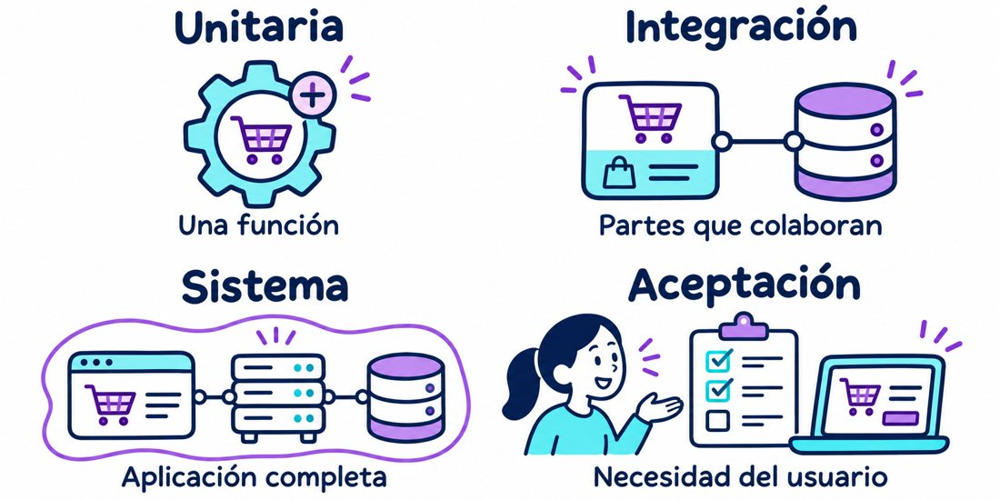
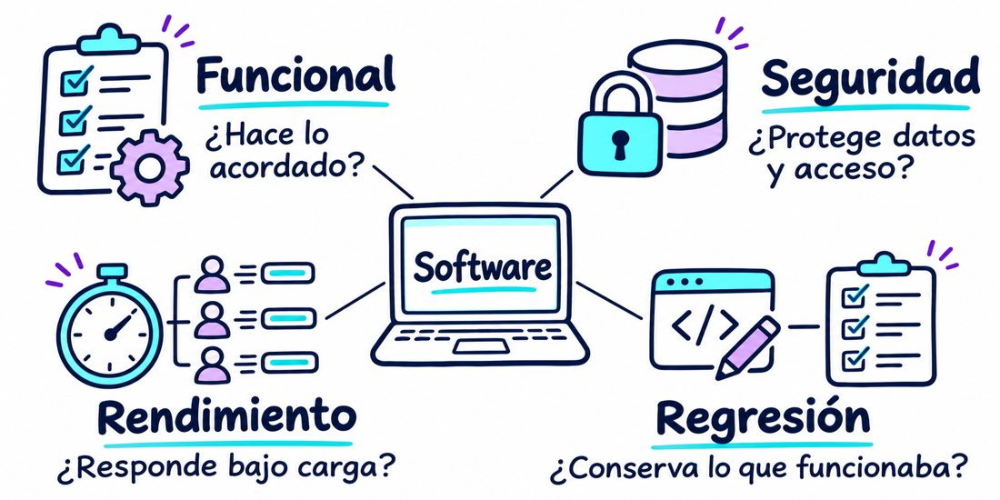
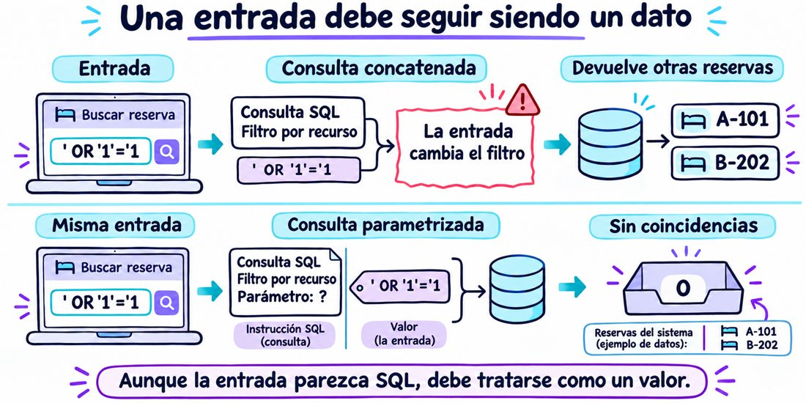
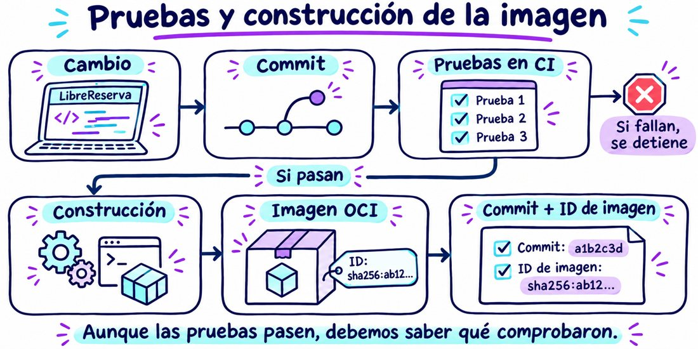

# Pruebas automatizadas y entrega trazable

**Sesión 12 · miércoles 4 de noviembre de 2026 · 6:00 a 10:00 p. m.**

Las pruebas aportan evidencia sobre el comportamiento del software. Primero se explica qué comprobamos, para qué lo hacemos y cómo elegimos los casos. Un ejemplo de una compra permite comprender resultado esperado y observado antes de estudiar código.

La pregunta que conduce el encuentro es: **si cambiamos LibreReserva, ¿cómo comprobamos que sigue funcionando y cuál imagen contiene ese cambio?**

Los [ejercicios para estudiantes](../../../modules/07_pruebas/EJERCICIOS_SESION12.md) contienen los comandos y las diferencias esperadas. La [plantilla de evidencia](../../../modules/07_pruebas/EVIDENCIA_SESION12.md) organiza la entrega.

## Resultado de aprendizaje

Al finalizar, cada equipo podrá convertir un riesgo en una comprobación automática, demostrar que esa comprobación detecta un error y relacionar el resultado de CI con un commit y una imagen. El trabajo obligatorio se limita a **dos riesgos, una regresión controlada y una cadena de evidencia**. El docente introduce además el riesgo de inyección SQL mediante una consulta con datos ficticios; los equipos pueden elegirlo como uno de sus dos casos. Un tercer riesgo queda como ampliación.

## Preparación del encuentro

El docente prepara una ejecución correcta de CI y una ejecución con una prueba fallida, correspondientes a la misma regla. Conserva sus registros y descarga el artefacto de la ejecución correcta, que el flujo actual retiene durante tres días. Si no hay conexión, estos registros permiten recorrer el proceso y los equipos ejecutan las pruebas localmente; la comprobación de CI queda registrada como pendiente.

Cada equipo llega con el repositorio actualizado, el entorno Python preparado y acceso a la forja utilizada por el curso. Desde la raíz del repositorio:

```bash
./scripts/setup_python.sh --apply
make test-sesion12
make check
make test-all
```

La instalación se realiza antes del encuentro. Para comenzar la demostración de dominio basta Python y la biblioteca estándar; el taller HTTP requiere las dependencias de `requirements-dev.txt`. Los ejemplos usan el entorno `.venv` en Linux o macOS y el adaptador en memoria para las pruebas HTTP. PostgreSQL se usa solo si el equipo ya tiene preparada una base exclusiva de pruebas.

## Distribución de las cuatro horas

| Horario | Desarrollo | Evidencia al terminar |
|---|---|---|
| 6:00–6:10 | Recuperar lo trabajado el 28 de octubre y registrar pendientes | Evidencia y brechas separadas |
| 6:10–6:50 | Explicar propósito, casos, ejecución y tipos de pruebas con una compra sencilla | Expectativas y clasificación justificadas |
| 6:50–7:10 | Aplicar los conceptos a LibreReserva y detectar una regresión funcional | Prueba verde, roja y verde |
| 7:10–7:30 | Introducir inyección SQL y comprobar una consulta parametrizada | Entrada normal y entrada que intenta alterar la consulta |
| 7:30–7:50 | Leer el flujo CI y explicar la construcción condicionada por las pruebas | Relación entre pasos del flujo |
| 7:50–8:00 | Pausa | |
| 8:00–9:25 | Taller por equipos sobre dos riesgos | Pruebas, regresión y resultado local o CI |
| 9:25–9:50 | Relacionar commit, ejecución e imagen | Registro de trazabilidad |
| 9:50–10:00 | Presentar evidencia y responder preguntas de cierre | Entrega breve por equipo |

## Fundamentos de las pruebas

Al ejecutar un caso comparamos un resultado observado con una expectativa acordada. Las pruebas ayudan a descubrir errores, valorar riesgos y revisar cambios con evidencia. Considere una compra sin descuentos ni cargos adicionales: dos productos de $20.000 y $30.000 deben sumar $50.000. Si la aplicación muestra $45.000, la comprobación detecta una diferencia que necesita explicación.

Un caso describe la situación inicial, la entrada, la acción y el resultado esperado. Una persona puede ejecutar sus pasos y registrar observaciones, o un programa puede repetirlos y comprobar condiciones mediante aserciones. Ambas formas pueden atender el mismo comportamiento.



Las unitarias se centran en una unidad aislada; las de integración comprueban partes que colaboran; las de sistema evalúan el conjunto; y la aceptación contrasta el producto con necesidades acordadas. Un recorrido completo de usuario suele llamarse E2E. La aceptación no representa una pieza de código más grande ni obliga a una secuencia rígida.



El propósito complementa el alcance. Las funcionales comprueban lo acordado; seguridad y rendimiento evalúan atributos de calidad; y la regresión busca comportamientos alterados por un cambio. Una misma prueba puede ser unitaria, funcional y útil para regresión. Pida al grupo clasificar un caso del carrito antes de estudiar LibreReserva.

Seleccione pocos casos por su impacto y probabilidad de fallo, con condiciones que permitan repetirlos. Aunque los casos elegidos pasen, quedan escenarios por revisar. Referencias: [unittest](https://docs.python.org/3/library/unittest.html), [tipos de pruebas en Microsoft Learn](https://learn.microsoft.com/en-us/dotnet/core/testing/) y [fundamentos de ISTQB, secciones 1 y 2](https://istqb.org/wp-content/uploads/2024/11/ISTQB_CTFL_Syllabus_v4.0.1.pdf).

## Aplicación a LibreReserva

Plantee al grupo: «La sala A-101 está reservada de 8 a 9. El equipo modifica la función que compara horarios. ¿Qué podría salir mal aunque la aplicación siga arrancando?».

Recoja tres respuestas: aceptar una reserva incompatible, rechazar una reserva permitida o responder con un código que el cliente interpreta mal. Tener el proceso encendido permite recibir solicitudes, pero necesitamos comprobar además las reglas que resuelven esas solicitudes.

Pida que cada equipo describa una capacidad implementada y otra pendiente. Idempotencia, errores y disponibilidad ya se explicaron el 28 de octubre; hoy aportan casos que podrían probarse. En la referencia actual, `/salud/lista` responde un valor fijo y aún no existe manejo de claves de idempotencia. Los equipos que no hayan completado esas capacidades las registran como pendientes y eligen otros riesgos para el taller.

## Una prueba compara una expectativa con un resultado

Una prueba automatizada es un programa pequeño que prepara una situación, ejecuta una acción y comprueba el resultado. La **aserción** expresa la condición que debe cumplirse. Cuando esa condición no se cumple, la prueba falla y ayuda a localizar el cambio que alteró el comportamiento.

Use este caso antes de enseñar código:

| Paso | Caso de LibreReserva |
|---|---|
| Preparar | Una reserva de A-101 de 8:00 a 9:00 y otra de 9:00 a 10:00 |
| Actuar | Preguntar si los intervalos se solapan |
| Comprobar | El resultado debe ser falso porque las reservas son contiguas |

La regla nace de una decisión del dominio: el final de una reserva puede coincidir con el inicio de la siguiente. Aunque una implementación parezca razonable, la prueba debe comprobar esa decisión con un caso concreto.

Este es un ejemplo existente en [las pruebas de dominio](../../../labs/librereserva/tests/test_domain.py):

```python
def test_intervalos_contiguos_no_se_solapan(self) -> None:
    primero = Intervalo(self.inicio, self.inicio + timedelta(hours=1))
    segundo = Intervalo(
        self.inicio + timedelta(hours=1),
        self.inicio + timedelta(hours=2),
    )
    self.assertFalse(primero.se_solapa(segundo))
```

El docente lee primero el nombre de la prueba, después los horarios y finalmente `assertFalse`. El estudiante debe poder explicar el resultado esperado antes de ejecutar el comando.

## Elegir pruebas según el riesgo

Los nombres ayudan a describir qué se comprueba y qué componentes participan. Una prueba HTTP con una base real también puede ser una prueba de integración; estas categorías pueden coincidir.

| Alcance | Pregunta que responde | Ejemplo y ubicación |
|---|---|---|
| Unitario de dominio | ¿La regla calcula o valida lo esperado? | Rechazar duración cero y permitir intervalos contiguos en [test_domain.py](../../../labs/librereserva/tests/test_domain.py) |
| Contrato del repositorio | ¿Los adaptadores respetan los mismos comportamientos? | Crear, listar, borrar y rechazar solapamientos en [test_repository_contract.py](../../../labs/librereserva/tests/test_repository_contract.py) |
| Integración con PostgreSQL | ¿El adaptador y la base trabajan correctamente juntos? | El mismo contrato y dos escrituras concurrentes en [test_repository_contract.py](../../../labs/librereserva/tests/test_repository_contract.py) |
| HTTP | ¿El cliente recibe la respuesta acordada? | Crear con `201`, rechazar conflicto con `409` y borrar con `204` en [test_http.py](../../../modules/07_pruebas/test_http.py) |

La prueba HTTP actual usa `TestClient` dentro de Python y el adaptador que selecciona la aplicación; por defecto es memoria. Por eso puede pasar sin comprobar puertos, Caddy, contenedores o PostgreSQL. La prueba de contrato contra PostgreSQL sí necesita una base real y `LIBRERESERVA_TEST_DATABASE_URL`.

Las pruebas de PostgreSQL aplican la migración y vacían la tabla de reservas. Se ejecutan contra una base exclusiva de pruebas, separada de los datos de la aplicación. Su preparación no es un requisito nuevo de este encuentro.

Para elegir los dos riesgos del taller, prefiera uno de dominio y otro HTTP o de seguridad:

| Riesgo | Entrada | Resultado esperado | Alcance inicial |
|---|---|---|---|
| Rechazar una reserva permitida | A-101 de 8 a 9, seguida de 9 a 10 | Ambas se permiten | Dominio |
| Aceptar dos reservas incompatibles | A-101 de 8 a 9, seguida de 8:30 a 9:30 | La segunda se rechaza | HTTP |
| Reservar una duración inválida | Fin igual al inicio | Rechazo de la regla y `422` al usar la API | Dominio o HTTP |
| Borrar una reserva equivocada | Dos reservas y el ID de una de ellas | Se conserva la otra | Repositorio o HTTP |
| Alterar el filtro de una consulta | Una entrada que intenta cambiar el significado de SQL | La entrada se trata como dato y no amplía los resultados | Consulta con datos ficticios |

## Riesgo de seguridad en una consulta

Suponga que queremos añadir una búsqueda de reservas por sala. El usuario escribe `A-101` y espera obtener solo las reservas de esa sala. **Esta búsqueda es una ampliación didáctica posible**: el endpoint actual `GET /reservas` lista todas las reservas y aún no ofrece este filtro.

El riesgo aparece si el programa construye SQL pegando directamente el texto del usuario. Una entrada podría cambiar la condición de búsqueda y devolver reservas de otras salas. A esto se le llama **inyección SQL**. La separación entre instrucciones SQL y valores mediante parámetros es una de las defensas principales. [Guía de prevención de OWASP](https://cheatsheetseries.owasp.org/cheatsheets/SQL_Injection_Prevention_Cheat_Sheet.html).



### Explicar el problema con dos salas

Prepare dos registros ficticios: uno de A-101 y otro de B-202. Una construcción insegura sería:

```python
# Ejemplo inseguro para analizar en clase.
sql = f"SELECT id, recurso FROM reservas WHERE recurso = '{recurso}'"
```

Si `recurso` contiene `A-101`, el resultado parece correcto. Si contiene la entrada de laboratorio `' OR '1'='1`, la instrucción queda así:

```sql
SELECT id, recurso FROM reservas WHERE recurso = '' OR '1'='1'
```

La comparación `'1'='1'` siempre es verdadera y amplía la selección a las dos salas. Aunque la consulta funcione con una entrada normal, necesitamos comprobar que una entrada diferente no cambie su significado.

### Separar la consulta y el valor

Con PostgreSQL y psycopg, el ejemplo se escribiría así:

```python
conexion.execute(
    "SELECT id, recurso FROM reservas WHERE recurso = %s",
    (recurso,),
)
```

La consulta conserva su estructura y el controlador recibe el recurso como un valor separado. `%s` es un marcador de psycopg; no se sustituye mediante una f-string, el operador `%` ni concatenación, y no se encierra entre comillas. [Parámetros de consultas en psycopg](https://www.psycopg.org/psycopg3/docs/basic/params.html).

El [adaptador PostgreSQL actual](../../../labs/librereserva/app/adapters/postgres.py) ya sigue esta práctica al insertar una reserva y al borrar por ID. La demostración explica qué riesgo evita; no afirma que exista esta consulta vulnerable en la aplicación actual. Parametrizar evita interpretar los valores como SQL, mientras que decidir qué usuario puede consultar cada reserva requiere controles de autorización adicionales.

### Ejecutar la comprobación sin preparar infraestructura

El archivo [test_consulta_segura.py](../../../modules/07_pruebas/test_consulta_segura.py) utiliza SQLite en memoria y datos ficticios. Sirve para observar la misma separación entre consulta y dato con la biblioteca estándar de Python; LibreReserva conserva PostgreSQL como base de su arquitectura. En sqlite3 el marcador es `?`, mientras que en psycopg es `%s`. [Parámetros de consultas en sqlite3](https://docs.python.org/3/library/sqlite3.html).

```bash
python3 modules/07_pruebas/test_consulta_segura.py
```

Las tres comprobaciones verifican una búsqueda normal, un nombre que contiene apóstrofe y una entrada que intenta alterar SQL. Para esta última, el resultado esperado es vacío porque no hay una sala cuyo nombre sea literalmente `' OR '1'='1`.

Para demostrar una regresión de seguridad, en una rama de práctica cambie solo el cuerpo de `buscar_por_recurso` por esta versión insegura:

```python
return conexion.execute(
    f"SELECT id, recurso FROM reservas WHERE recurso = '{recurso}' ORDER BY id"
).fetchall()
```

Ejecute únicamente el caso de seguridad:

```bash
python3 modules/07_pruebas/test_consulta_segura.py \
  ConsultaSeguraTest.test_entrada_sql_no_amplia_los_resultados
```

La prueba debe fallar porque devuelve las dos filas. Restaure después la consulta parametrizada y ejecute de nuevo las tres pruebas. El archivo se incluye en la selección de pytest que ya usa CI; su resultado verifica este ejemplo docente, no la seguridad completa del adaptador PostgreSQL ni de la aplicación.

La pregunta de cierre del caso es: «¿Nuestra prueba comprueba que la búsqueda encuentra A-101 y también que una entrada no puede ampliar la consulta?». Eliminar apóstrofes a mano podría rechazar nombres válidos; la parametrización permite conservarlos como datos.

## Demostración de una regresión

Una regresión aparece cuando un cambio altera un comportamiento que antes funcionaba. La demostración utiliza una prueba existente y dura unos diez minutos.

1. Ejecute desde la raíz del repositorio:

   ```bash
   python3 -m unittest labs.librereserva.tests.test_domain.IntervaloTest.test_intervalos_contiguos_no_se_solapan -v
   ```

2. Abra [domain.py](../../../labs/librereserva/app/domain.py). La regla correcta es:

   ```python
   return self.inicio < otro.fin and otro.inicio < self.fin
   ```

3. En una rama de práctica, cambie solo las comparaciones de esa línea:

   ```python
   return self.inicio <= otro.fin and otro.inicio <= self.fin
   ```

4. Antes de ejecutar, pida una predicción. Con `<=`, el instante compartido de las 9:00 se interpreta como un solapamiento. Repita el mismo comando y observe el fallo de la aserción.
5. Restaure la línea correcta y vuelva a ejecutar. La prueba debe pasar otra vez.
6. Lea el resultado como una secuencia de evidencia: comportamiento correcto, error detectado y corrección comprobada. En este ejemplo no se cambia la expectativa para que el resultado vuelva a estar verde, porque la regla de negocio sigue siendo la misma.

La comprobación local introduce el caso. El docente muestra después una ejecución CI fallida con esa modificación y el paso de construcción omitido. Los equipos pueden repetirla en una rama de práctica; la entrega final debe contener la implementación restaurada.

## Leer una prueba HTTP

En [test_http.py](../../../modules/07_pruebas/test_http.py) ya existe este caso:

```python
def test_api_crea_y_rechaza_solapamiento() -> None:
    datos = {
        "recurso": "A-101",
        "inicio": "2026-08-10T08:00:00Z",
        "fin": "2026-08-10T09:00:00Z",
    }
    assert client.post("/reservas", json=datos).status_code == 201
    assert client.post("/reservas", json=datos).status_code == 409
```

El `setup_function` del archivo limpia el repositorio antes de cada prueba. La primera solicitud debe crear la reserva; la segunda debe informar un conflicto. El estado inicial conocido permite repetir el caso sin depender de reservas creadas en otra prueba.

Para ejecutar solamente este caso con memoria:

```bash
LIBRERESERVA_REPOSITORY=memory .venv/bin/python -m pytest \
  modules/07_pruebas/test_http.py::test_api_crea_y_rechaza_solapamiento -v
```

El conflicto `409` comprueba el rechazo de un solapamiento. Para afirmar que existe idempotencia se necesitaría probar además el contrato de una clave idempotente y la repetición de su resultado; este caso no verifica esa capacidad.

Como ampliación breve, el equipo puede conservar el código esperado y añadir una consulta que compruebe que queda exactamente una reserva con los datos solicitados. Así conecta la respuesta HTTP con el efecto observable.

## Integración continua y lectura del YAML

**Integración continua o CI** significa ejecutar comprobaciones automáticas al incorporar cambios al repositorio. Un **workflow** describe el proceso; una **ejecución** es una ocasión concreta en que ese proceso corre. Los registros muestran qué pasó en cada paso.



Abra [validate.yml](../../../.github/workflows/validate.yml). Este archivo YAML describe eventos de inicio, permisos, ambiente de ejecución y pasos. Relacione las claves con las acciones que ya conoce el grupo:

| Parte del archivo | Significado en este repositorio |
|---|---|
| `on: push` y `pull_request` | Iniciar las comprobaciones al subir cambios o al abrir o actualizar una propuesta de integración |
| `jobs` y `runs-on` | Agrupar pasos y elegir la máquina que los ejecuta |
| `steps` con `uses` | Reutilizar acciones para obtener el código, preparar Python o guardar archivos |
| `steps` con `run` | Ejecutar comandos como los que se usan en la terminal |

Recorra el flujo actual en este orden:

1. Obtener el código y preparar Python 3.13.
2. Validar estructura, scripts, código, pruebas básicas y enlaces.
3. Instalar las dependencias académicas y ejecutar la suite con pytest.
4. Construir la imagen y registrar su ID.
5. Guardar la imagen comprimida y `image-id.txt` como un artefacto descargable.

Los pasos de construcción actuales usan la condición de éxito predeterminada de GitHub Actions. Si una prueba falla, la construcción posterior se omite. El equipo debe mostrar el resultado del paso, además del color general de la ejecución. [Condiciones de estado de GitHub Actions](https://docs.github.com/en/actions/reference/workflows-and-actions/expressions#status-check-functions).

El flujo actual no prepara un servicio PostgreSQL ni define la conexión de pruebas. Por eso las pruebas de PostgreSQL se omiten en la configuración de referencia. Este encuentro distingue lo ejecutado de lo pendiente; agregar un servicio de base de datos a CI queda como ampliación para equipos que ya lo tengan preparado.

## Interpretar los resultados

| Resultado | Interpretación |
|---|---|
| Pasó | La condición comprobada se cumplió en esa ejecución |
| Falló | Una expectativa no se cumplió o la prueba encontró un error de ejecución |
| Omitida o `skipped` | Ese caso no se ejecutó; debe registrarse el motivo |

Si se ejecutan nueve pruebas y se omiten tres por falta de PostgreSQL, el resultado permite hablar de esas nueve comprobaciones. Aunque todas las pruebas ejecutadas pasen, debemos revisar cuáles quedaron fuera y qué riesgos cubren sus aserciones.

La cobertura de código puede ayudar a localizar líneas no ejercitadas. En este encuentro se prioriza demostrar que una prueba detecta el error elegido; no se pide incorporar una herramienta de cobertura ni alcanzar un porcentaje arbitrario.

## Relacionar código e imagen

La trazabilidad permite responder qué código se comprobó y qué artefacto se obtuvo. Use una ejecución correcta de CI y siga sus identificadores:

| Elemento | Qué identifica | Dónde verlo |
|---|---|---|
| Commit | Una revisión del repositorio | SHA de la revisión probada en CI |
| Ejecución CI | Los pasos, resultados y registros de esa comprobación | Página de la ejecución y sus logs |
| Etiqueta de imagen | Un nombre asignado a la imagen; puede reasignarse | `localhost/librereserva:<SHA>` en el comando de construcción |
| ID de imagen | El identificador de contenido de la imagen en el motor local | `image-id.txt`, generado con `docker image inspect` |
| Artefacto CI | Los archivos conservados por esa ejecución | Archivo de imagen comprimido y su registro de ID |

En un evento `pull_request`, `github.sha` puede corresponder al commit de integración de prueba creado por GitHub. Copie la revisión que realmente usó la ejecución, en lugar de asumir que siempre coincide con el último commit de la rama del equipo. [Eventos de pull request en GitHub Actions](https://docs.github.com/en/actions/reference/workflows-and-actions/events-that-trigger-workflows#pull_request).

Para practicar la relación localmente con Docker, primero compruebe que el código y los archivos que entran a la imagen coinciden con el commit. Registre la revisión y construya:

```bash
git status --short
git rev-parse HEAD
```

Copie el SHA mostrado para completar el siguiente comando, sustituyendo `SHA_DEL_COMMIT`:

```bash
docker build -f labs/librereserva/Containerfile \
  -t localhost/librereserva:SHA_DEL_COMMIT labs/librereserva
docker image inspect localhost/librereserva:SHA_DEL_COMMIT --format '{{.Id}}'
```

El ID corresponde a esa construcción local. No se exige que coincida con el de una construcción independiente en CI: pueden variar plataforma, imagen base o dependencias. Para identificar exactamente la imagen de CI, consulte el ID y el archivo de esa misma ejecución. [Referencia de inspección de imágenes Docker](https://docs.docker.com/reference/cli/docker/image/inspect/).

El flujo guarda un archivo descargable durante tres días. Publicar una imagen en un registro y desplegarla son acciones distintas. En esta sesión se sigue el recorrido que el repositorio ya implementa: comprobar, construir y conservar evidencia.

## Taller por equipos

1. **Elegir dos riesgos.** Uno de dominio y otro HTTP, de seguridad o de integración ya disponible. Escribir entrada, expectativa y consecuencia de aceptar un resultado incorrecto. El caso de seguridad puede utilizar el ejemplo aislado de consultas.
2. **Relacionar cada riesgo con una prueba.** Leer una prueba existente y completar o mejorar otra. Si se reutiliza una prueba, explicar qué comprueba y qué queda fuera.
3. **Ejecutar desde un estado conocido.** Registrar el comando, los resultados y las omisiones. En HTTP, usar memoria para evitar modificar datos de una aplicación compartida.
4. **Demostrar una regresión.** Introducir un error pequeño en una rama de práctica, predecir el fallo, ejecutarlo y restaurar la regla. Conservar evidencia de ambos resultados.
5. **Recorrer CI.** Identificar la revisión, el paso de pruebas y la condición que permite construir. Relacionar una ejecución fallida con la construcción omitida.
6. **Registrar la imagen.** En una ejecución correcta, reunir SHA probado, enlace de CI, etiqueta, ID y nombre del artefacto. Si una parte no se ejecutó, registrarla como pendiente.

Si el equipo termina antes, puede reforzar la comprobación HTTP o ejecutar el contrato en su PostgreSQL de pruebas. No se exige implementar nuevas capacidades de API durante este taller.

### Formato breve de evidencia

Complete esta ficha en la entrega del equipo, junto con el enlace al pull request:

```text
Equipo:
Riesgo 1 y resultado esperado:
Riesgo 2 y resultado esperado:
Archivos y nombres de las pruebas:
Comando ejecutado:
Pruebas aprobadas / fallidas / omitidas y motivo:
Error introducido y prueba que lo detectó:
Evidencia después de restaurar la implementación:
SHA probado por CI y tipo de evento:
Enlace de la ejecución correcta:
Enlace de la ejecución fallida y estado de la construcción:
Etiqueta e ID de la imagen de esa ejecución:
Nombre del artefacto descargable:
Pendientes y límites de la comprobación:
```

### Criterios para revisar la entrega

| Criterio | Evidencia suficiente |
|---|---|
| Comprensión del riesgo | Explica qué puede salir mal y por qué importa al usuario |
| Calidad de la prueba | Tiene entrada y estado inicial claros, acción y aserción útil |
| Detección de regresión | La prueba falla con el error y pasa con la regla restaurada |
| Lectura de CI | Distingue pruebas ejecutadas, omitidas y pasos de construcción |
| Trazabilidad | Relaciona revisión probada, ejecución e imagen sin confundir sus identificadores |

## Cierre con preguntas al grupo

- Si la API arranca, ¿qué falta comprobar para aceptar una reserva?
- Si una prueba HTTP pasa con memoria, ¿qué necesitaríamos para afirmar que PostgreSQL funciona?
- Si una prueba se omite, ¿qué evidencia queda pendiente?
- Si una entrada parece una instrucción SQL, ¿cómo garantizamos que siga siendo un valor de búsqueda?
- Si una etiqueta se reasigna, ¿qué registro permite identificar la imagen construida en una ejecución?
- Si una prueba falla, ¿qué paso del flujo debe detenerse y dónde lo observamos?

El 11 de noviembre se utilizará esta evidencia para trabajar configuración segura y despliegue reproducible. El encuentro de hoy termina cuando el equipo puede explicar sus pruebas y seguir la relación entre un cambio y su imagen.

## Consulta técnica

- [Aserciones y resultados de pytest](https://docs.pytest.org/en/stable/how-to/assert.html).
- [Flujo CI del repositorio](../../../.github/workflows/validate.yml).
- [Agenda y alcance de la sesión](README.md).
