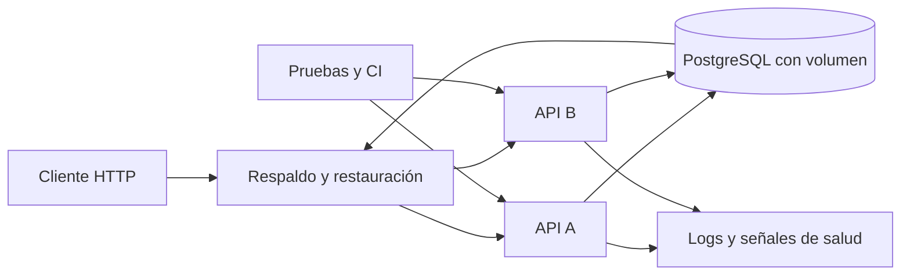
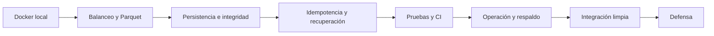

# LibreReserva robusta: ruta acumulativa por sesiones

Esta ruta parte de lo que se alcanzó el 14 de octubre: construir una imagen Docker, ejecutar LibreReserva en un contenedor y probar el despliegue local. Las semanas 10–16 evolucionan esa misma aplicación. No se abre una ruta paralela con otra API, otro modelo de datos u otra plataforma.

## Arquitectura de trabajo

El objetivo no es declarar la arquitectura robusta, sino demostrar garantías: datos durables, integridad concurrente, repetición segura, entrega trazable, diagnóstico y recuperación.

## Recorrido obligatorio

| Sesión | Pregunta que orienta la clase | Incremento obligatorio | Evidencia |
|---:|---|---|---|
| 9 · 14 oct. | ¿Puedo ejecutar la misma aplicación en un contenedor? | Imagen, contenedor, API local y reinicio | Construcción, endpoints y pérdida de estado demostrada |
| 10 · 27 oct. | ¿Qué ocurre cuando dos instancias comparten un archivo? | Caddy, dos API, Parquet compartido y bloqueo local | Carrera observada, mitigación y límites documentados |
| 11 · 28 oct. | ¿Cómo sobreviven los datos sin violar las reglas? | Puerto de repositorio, PostgreSQL, migraciones y transacción | Reinicio con datos y prueba concurrente |
| 12 · 4 nov. | ¿Cómo responde la API ante repeticiones y dependencias caídas? | Idempotencia, errores, vida y disponibilidad real | Repetición sin duplicado y recuperación de PostgreSQL |
| 13 · 11 nov. | ¿Cómo relaciono un cambio con pruebas y una imagen segura? | Pruebas, CI, etiqueta de commit y configuración externa | Pipeline, imagen trazable y revisión de secretos |
| 14 · 18 nov. | ¿Cómo diagnostico y recupero el servicio? | Logs, correlación, medición, respaldo y restauración | Caso de fallo, runbook y restauración verificada |
| 15 · 25 nov. | ¿Puede otro entorno reproducir todo el sistema? | Integración desde clon limpio | Versión candidata y bitácora de cuatro horas |
| 16 · 2 dic. | ¿Puede el equipo demostrar y defender las garantías? | Demostración completa | Caso feliz, fallo, recuperación y ADR |

## Alcance técnico fijo

- Una API: LibreReserva con FastAPI.
- Un estilo: monolito modular.
- Un motor de contenedores por equipo: Docker o Podman con comandos equivalentes.
- Un balanceador local: Caddy para distribuir solicitudes entre dos instancias.
- Un almacén durable: PostgreSQL.
- Un descriptor local: Compose.
- Una forja y un flujo CI: la ya utilizada por el repositorio.
- Una estrategia de operación: logs estructurados, salud real, respaldo y restauración.

No forman parte de la ruta evaluable: RabbitMQ, SQS, Lambda, una segunda API serverless, Kubernetes, Forgejo adicional ni una pila completa de telemetría.

## Estado del material

| Capacidad | Estado inicial | Resultado esperado |
|---|---|---|
| API Docker con agenda en RAM | Implementado | Se conserva como línea base de la sesión 9 |
| Parquet compartido | Experimento de sesión 10 | Evidencia de carreras y límites del bloqueo local; no es el almacén final |
| PostgreSQL con volumen | Integrado mediante puerto y adaptador | Se conserva como almacén de las sesiones siguientes |
| Migraciones | Implementada la versión `001` | El esquema se prepara antes de las réplicas |
| Exclusión concurrente | Implementada en PostgreSQL | Dos reservas incompatibles producen `201` y `409` |
| Idempotencia | Por implementar | Una repetición no crea un segundo efecto |
| Salud de disponibilidad | Respuesta fija | Comprueba realmente PostgreSQL |
| CI e imagen | Flujo base disponible | Ejecuta pruebas y relaciona imagen con commit |
| Logs y correlación | Por implementar | Permiten seguir una solicitud y diagnosticar un fallo |
| Respaldo y restauración | Por documentar | Restauración comprobada en un volumen limpio |

## Control de carga

Cada sesión modifica la misma rama de trabajo y termina con un pull request pequeño. No se instala una plataforma nueva para reemplazar una garantía que todavía falta en la aplicación. La jornada de la semana 15 integra y corrige; no añade funcionalidades ni infraestructura. La sesión 16 no permite cambios de arquitectura: demuestra lo construido y registra la deuda restante.
