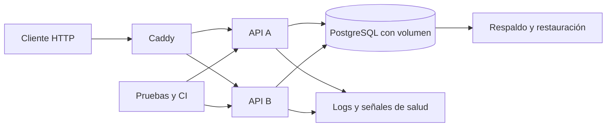
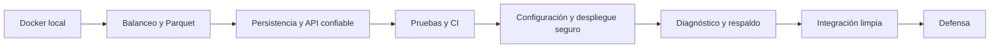

# LibreReserva robusta: ruta acumulativa por sesiones

Esta ruta parte de lo que se alcanzó el 14 de octubre: construir una imagen Docker, ejecutar LibreReserva en un contenedor y probar el despliegue local. Las semanas 10–16 evolucionan esa misma aplicación. No se abre una ruta paralela con otra API, otro modelo de datos u otra plataforma.

Actualización del 2 de noviembre: el docente confirmó que idempotencia, errores, vida/disponibilidad y recuperación de PostgreSQL ya se trabajaron el 28 de octubre. El 4 de noviembre continúa con pruebas y CI. Los pendientes de implementación se comprueban al inicio y se registran por equipo, sin volver a dictar la misma clase.

## Arquitectura de trabajo

El objetivo no es declarar la arquitectura robusta, sino demostrar garantías: datos durables, integridad concurrente, repetición segura, entrega trazable, diagnóstico y recuperación.

## Recorrido obligatorio

| Sesión | Pregunta que orienta la clase | Incremento obligatorio | Evidencia |
|---:|---|---|---|
| 9 · 14 oct. | ¿Puedo ejecutar la misma aplicación en un contenedor? | Imagen, contenedor, API local y reinicio | Construcción, endpoints y pérdida de estado demostrada |
| 10 · 27 oct. | ¿Qué ocurre cuando dos instancias comparten un archivo? | Caddy, dos API, Parquet compartido y bloqueo local | Carrera observada, mitigación y límites documentados |
| 11 · 28 oct. | ¿Cómo conservar datos y responder a repeticiones/fallos? | Persistencia e integridad y temas de API confiable ya trabajados | Registrar lo enseñado y la evidencia disponible por equipo |
| 12 · 4 nov. | ¿Cómo detecto una regresión antes de entregar? | Pruebas por riesgo, CI y etiqueta de commit | Prueba que detecta un fallo, ejecución CI e imagen identificada |
| 13 · 11 nov. | ¿Cómo despliego sin incorporar secretos a la imagen? | Configuración externa, permisos, migraciones y arranque reproducible | Misma imagen, configuración documentada y ausencia de secretos |
| 14 · 18 nov. | ¿Cómo diagnostico un fallo y recupero los datos? | Logs, correlación, medición, respaldo y restauración | Caso de fallo diagnosticado, runbook y restauración verificada |
| 15 · 25 nov. | ¿Puede otro entorno reproducir todo el sistema? | Integración desde clon limpio | Versión candidata y bitácora de cuatro horas |
| 16 · 2 dic. | ¿Puede el equipo demostrar y defender las garantías? | Demostración completa | Caso feliz, fallo, recuperación y ADR |

## Alcance técnico fijo

- Una API: LibreReserva con FastAPI.
- Un estilo: monolito modular.
- Un motor de contenedores por equipo: Docker o Podman con comandos equivalentes.
- Un balanceador local: Caddy para distribuir solicitudes entre dos instancias.
- Un almacén durable: PostgreSQL.
- Un descriptor local: Compose.
- Una forja y un flujo CI: la ya utilizada por el repositorio.
- Una estrategia de operación: logs estructurados, salud real, respaldo y restauración.

No forman parte de la ruta evaluable: RabbitMQ, SQS, Lambda, una segunda API serverless, Kubernetes, Forgejo adicional ni una pila completa de telemetría.

## Estado del material

| Capacidad | Estado de la referencia del repositorio | Resultado esperado |
|---|---|---|
| API Docker con agenda en RAM | Implementado | Se conserva como línea base de la sesión 9 |
| Parquet compartido | Experimento de sesión 10 | Evidencia de carreras y límites del bloqueo local; no es el almacén final |
| PostgreSQL con volumen | Integrado mediante puerto y adaptador | Se conserva como almacén de las sesiones siguientes |
| Migraciones | Implementada la versión `001` | El esquema se prepara antes de las réplicas |
| Exclusión concurrente | Implementada en PostgreSQL | Dos reservas incompatibles producen `201` y `409` |
| Idempotencia | Tema ya trabajado en clase; implementación pendiente en la referencia | Una repetición no crea un segundo efecto |
| Salud de disponibilidad | Tema ya trabajado en clase; la referencia todavía responde un valor fijo | Comprueba realmente PostgreSQL |
| CI e imagen | Flujo base disponible | Ejecuta pruebas y relaciona imagen con commit |
| Logs y correlación | Por implementar | Permiten seguir una solicitud y diagnosticar un fallo |
| Respaldo y restauración | Por documentar | Restauración comprobada en un volumen limpio |

## Control de carga

Cada sesión modifica la misma rama de trabajo y termina con un pull request pequeño. No se instala una plataforma nueva para reemplazar una garantía que todavía falta en la aplicación. La jornada de la semana 15 integra y corrige; no añade funcionalidades ni infraestructura. La sesión 16 no permite cambios de arquitectura: demuestra lo construido y registra la deuda restante.

En sesión 12 se seleccionan pocos riesgos para mostrar cómo una prueba los detecta. La revisión inicial de los temas del 28 de octubre dura 10 minutos; después se dedican 40 minutos a fundamentos antes de estudiar LibreReserva. Los equipos con pendientes conservan un registro de implementación y reciben acompañamiento sin detener el avance de todo el grupo. Configuración/secretos se trabajan el 11 de noviembre y respaldo/restauración el 18, en lugar de agregarlos al taller de CI.
