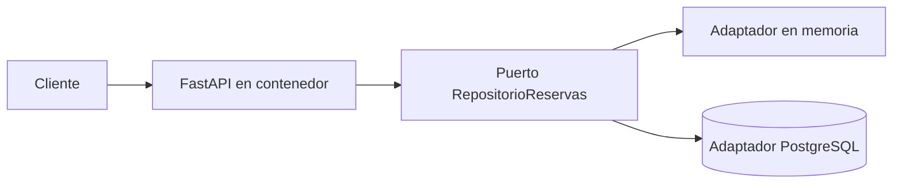

# Módulo 6. API, persistencia y consistencia

## Resultado

Convertir LibreReserva en una aplicación durable y confiable mediante PostgreSQL, migraciones, integridad concurrente, idempotencia y señales reales de disponibilidad.

El [laboratorio acumulativo](LABORATORIO.md) cubre dos sesiones: la sesión 11 conecta la API a PostgreSQL y la sesión 12 trata repeticiones y fallos. No introduce mensajería ni una segunda implementación de la API.

## Arquitectura



El adaptador en memoria conserva pruebas rápidas. PostgreSQL es el almacén del ambiente integrado y debe proteger las reglas que pueden romperse mediante solicitudes concurrentes.

## Instalación paso a paso

Revise el archivo Compose y muestre el plan antes de crear el contenedor:

```bash
sed -n '1,200p' modules/06_apis_datos_eventos/compose.yml
./modules/06_apis_datos_eventos/start_services.sh --motor docker
./modules/06_apis_datos_eventos/start_services.sh --motor docker --apply
docker exec librereserva-postgres pg_isready -U curso -d reservas
docker compose -f modules/06_apis_datos_eventos/compose.yml run --rm migracion
docker compose -f modules/06_apis_datos_eventos/compose.yml \
  up -d api_a api_b balanceador
```

Use `podman` en los tres comandos si ese es el motor preparado por el equipo. El puerto se publica solo en `127.0.0.1`; las credenciales son exclusivamente de laboratorio.

## Temas

- Puertos y adaptadores.
- Migraciones versionadas.
- Transacciones e integridad concurrente.
- Contratos HTTP y códigos de error.
- Idempotencia de operaciones.
- Vida y disponibilidad.
- Caída y recuperación de dependencias.

## Ejercicio

Implemente el puerto de repositorio, el adaptador PostgreSQL y las migraciones. Demuestre persistencia después de reiniciar la API y una sola confirmación ante solicitudes concurrentes incompatibles. Después implemente la clave de idempotencia y haga que `/salud/lista` consulte realmente PostgreSQL.

La referencia ejecutable de la sesión 11 está distribuida así:

- `labs/librereserva/app/ports.py`: puerto del dominio.
- `labs/librereserva/app/adapters/memory.py`: adaptador de pruebas.
- `labs/librereserva/app/adapters/postgres.py`: adaptador integrado.
- `labs/librereserva/migrations/001_crear_reservas.sql`: esquema y exclusión.
- `labs/librereserva/tests/test_repository_contract.py`: contrato común y concurrencia.
- `compose.yml` y `Caddyfile`: PostgreSQL, dos API y balanceador.

## Validación

- La API usa PostgreSQL, no una tabla de demostración desconectada.
- Las migraciones funcionan desde una base vacía.
- La prueba concurrente detecta la ausencia de protección.
- Repetir la misma operación no duplica el efecto.
- Detener PostgreSQL afecta disponibilidad y no falsifica vida.
- Recuperar PostgreSQL restablece la operación sin perder datos.

**Evidencia:** migraciones, adaptadores, pruebas unitarias/integración/HTTP, reinicio con datos y matriz de fallo/recuperación.
