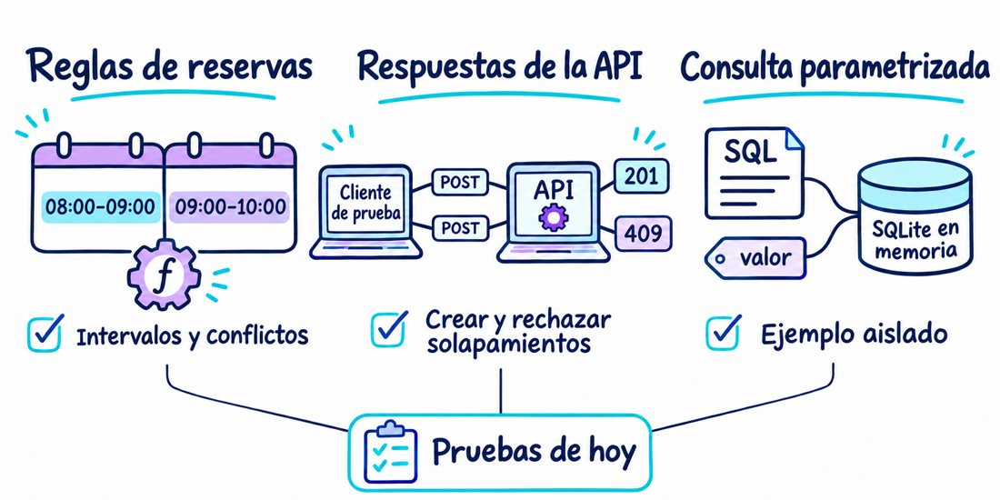
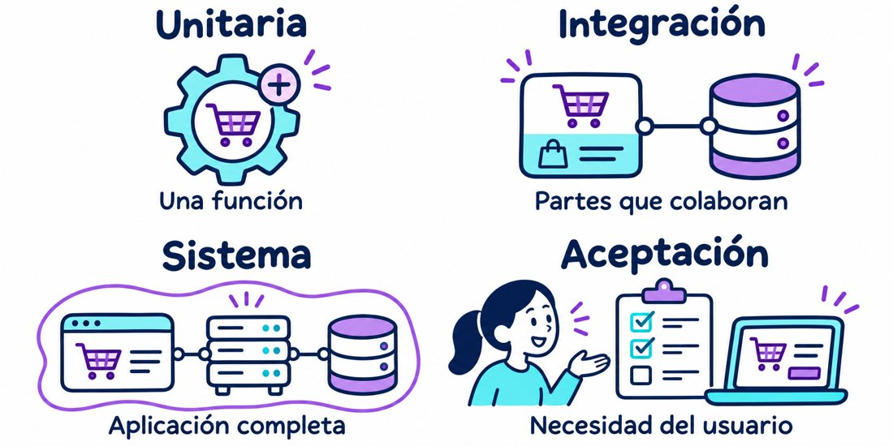
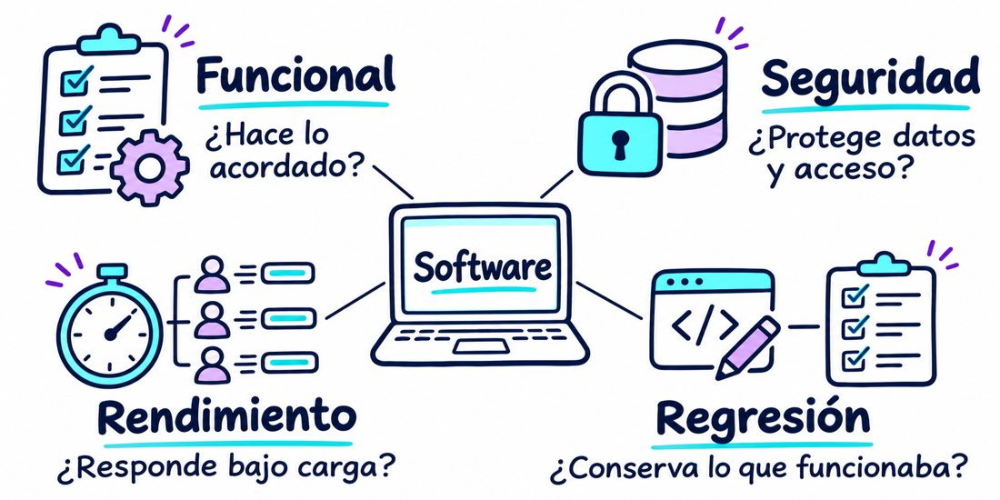

# Módulo 7. Pruebas y entrega trazable

## Resultado

Construir una estrategia de pruebas por riesgo y relacionar una revisión Git con una imagen OCI reproducible y configurada sin secretos embebidos.

La [sesión 12, del 4 de noviembre](../../aws-learner-lab/sesiones/12_distribuidos/README.md), usa este material para pruebas y CI, con una selección pequeña de riesgos. Configuración y secretos se trabajan por separado el 11 de noviembre. No es necesario completar toda la lista de ejercicios en el mismo encuentro.

El [desarrollo de la clase](../../aws-learner-lab/sesiones/12_distribuidos/DESARROLLO_CLASE.md) incluye ejemplos del código, una regresión controlada y una ficha para relacionar pruebas, CI e imagen.

## Ejercicios de la sesión 12

Abra la [guía para estudiantes](EJERCICIOS_SESION12.md) y complete la [plantilla de evidencia](EVIDENCIA_SESION12.md). Los dos ejercicios obligatorios comprueban reservas contiguas y una consulta parametrizada. Cada uno incluye primera ejecución, error controlado y restauración. HTTP se presenta como demostración y PostgreSQL como ampliación preparada.



## Tipos de pruebas

El alcance indica qué parte participa: una unidad aislada, varias partes, el sistema completo o la solución frente a necesidades acordadas. La ejecución puede ser manual o automatizada.



El propósito indica qué queremos comprobar. Las pruebas funcionales atienden lo acordado; seguridad y rendimiento evalúan atributos de calidad; regresión comprueba qué cambió respecto de un comportamiento esperado. Una prueba puede combinar alcance y propósito.



## Riesgo de seguridad en una consulta

El ejemplo [test_consulta_segura.py](test_consulta_segura.py) comprueba que una búsqueda usa la entrada como dato y evita ampliar el filtro mediante inyección SQL. Se ejecuta con `python3 modules/07_pruebas/test_consulta_segura.py` desde la raíz y también forma parte de la selección de pytest de CI. Usa SQLite en memoria con dos reservas ficticias; no es un nuevo endpoint ni una prueba del adaptador PostgreSQL. La guía de la clase explica el paso de consulta concatenada a parametrizada y la demostración de un fallo controlado.

## Instalación paso a paso

```bash
./scripts/setup_python.sh --apply
make test-sesion12
make check
make test-all
```

Las pruebas de integración requieren PostgreSQL y las migraciones del incremento persistente. Aunque un tema ya se haya enseñado, el equipo debe comprobar que su código lo implementa. Registre pruebas omitidas o capacidades pendientes sin tratarlas como verificadas por una ejecución verde.

## Pruebas disponibles

| Grupo | Archivo | Qué comprueba |
|---|---|---|
| Dominio y memoria | [test_domain.py](../../labs/librereserva/tests/test_domain.py) | Intervalos, conflictos y borrado |
| Contrato e integración | [test_repository_contract.py](../../labs/librereserva/tests/test_repository_contract.py) | Mismo acuerdo en memoria y PostgreSQL, con concurrencia en base real |
| HTTP | [test_http.py](test_http.py) | Creación, conflicto, borrado e inexistencia |
| Seguridad didáctica | [test_consulta_segura.py](test_consulta_segura.py) | Valores separados del SQL sobre datos ficticios |
| Propiedades | [test_properties.py](test_properties.py) | Intervalos contiguos con distintas duraciones generadas |

`make test-sesion12` ejecuta 13 pruebas sin servicios externos. `make test-all` añade contrato y propiedades; omite las tres de PostgreSQL si no está configurado. El [workflow](../../.github/workflows/validate.yml) ejecuta la suite antes de construir la imagen.

## Ampliaciones del proyecto

Las pruebas de idempotencia y disponibilidad real requieren completar esas capacidades de la API. La suite E2E automatizada y las pruebas de rendimiento todavía no están implementadas. Configuración y secretos se trabajan el 11 de noviembre; diagnóstico y recuperación, el 18. Estas ampliaciones no se añaden como ejercicios obligatorios de la sesión 12.

## Validación

```bash
make test-sesion12
make check
make test-all
git status --short
```

La cobertura informa qué código se ejecutó, pero no reemplaza aserciones sobre los riesgos. La evidencia debe identificar el commit, el resultado del pipeline y la imagen construida.

**Evidencia de la sesión 12:** dos riesgos, pruebas y regresión detectada, ejecuciones y omisiones, CI e identificadores de la imagen. Use la plantilla para distinguir lo comprobado de lo pendiente.
